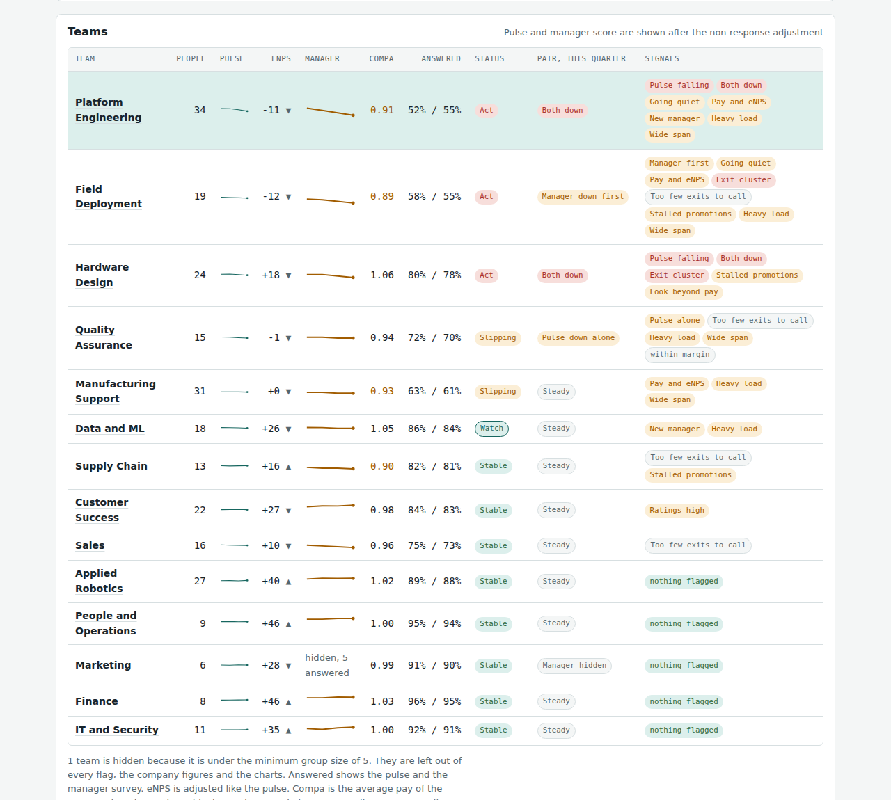

# People Signals

A small tool that reads team-level survey, pay and HR data and shows a leader where to look and what to ask first, before the exit survey does.

It runs in your browser. You choose a few CSV files, the page reads them on your computer, and nothing is uploaded, stored or sent anywhere. The code makes no network requests.

**Status: v0.1, beta.** It is an analysis workbook, not a validated predictor. The signals and thresholds are reasoned, not tested against real exits, and the demo data is invented. Read [docs/LIMITS.md](docs/LIMITS.md) before you use it on real data.



## What it does

Each team gets one status, so a leader sees a short list and not forty charts.

| Status | Meaning |
| --- | --- |
| Stable | Nothing has fired. |
| Watch | Two or more early signals (new manager, stalled promotions, heavy load, a very wide span) and nothing else has moved yet. |
| Slipping | A score has moved, response is falling, or pay or turnover is flagged. |
| Act | Pulse and manager score are both down, the pulse has fallen two quarters running, or exits bunch at one tenure point. |

Around that:

- **Both surveys together.** A short pulse and a short manager survey every quarter, read as a pair.
- **Non-response is counted.** Scores show the share of the team behind them, a range, and a setting for how much less favorable you assume silent people are.
- **Pay next to engagement.** Compa-ratio against pulse and eNPS, with exceptions flagged and a rule for when pay is an unlikely cause.
- **Early signals.** Manager changes, stalled promotions, workload and manager span.
- **Guards against small numbers.** Ranges on exit counts, margins of error on the pulse, ranges on every correlation, minimum group sizes, and manager scores hidden below a minimum number of answers.
- **Equity view.** Gaps between women and men in pay, promotion, exits, pulse and response, for the people who own pay.
- **What goes with staying.** Six pulse items against a plan-to-stay question.
- **What exits cost.** An estimated replacement cost, with the people a team wanted to keep shown separately.
- **Follow-through log.** An owner, an action and a date for each flag, and the status when it was raised next to the status now.
- **Backtest.** Flagged in one quarter, did people leave in the next? A first look, not a result.
- **Thresholds from your data.** One click sets the lines from what is normal across your teams.

## Quick start

1. Open `index.html` in a browser. No install, no server. The demo data loads.
2. Open **Load your own data**. Download the templates, fill them in, choose the files, and press **Check and load my files**. The page checks them and tells you what is wrong, row by row.

Only `teams.csv` and `quarterly.csv` are required. Each optional file switches on another view. File formats are in [docs/DATA.md](docs/DATA.md).

To host it for yourself, put the folder on any static host, for example GitHub Pages. There is nothing to run on a server.

## Use it with real data

Team-level files only, one row per team. Do not load one row per person. Before you use real people data:

- Agree the purpose, who sees what, and how long anything is kept, with legal and employee representatives where that applies. See [docs/PRIVACY.md](docs/PRIVACY.md).
- Keep the equity view with the people who own pay and fairness, not with line leaders.
- Do not use a status to judge a manager or a team. It is a prompt for a conversation.

## Project layout

```
index.html        the page
src/data.js       reads and checks the CSV files (no page access, tested)
src/app.js        the dashboard
src/demo.js       demo data and templates packed into one file (generated)
demo-data/        the invented demo data, as CSV
templates/        empty templates with one example row
docs/             method, data formats, limits, privacy
tests/            node tests/run.js
scripts/          build-demo.js
```

Run the checks with `node tests/run.js`. If you change `demo-data/` or `templates/`, run `node scripts/build-demo.js` to refresh `src/demo.js`.

## Contributing

The most useful contribution is a test on real data, with the owner's permission, and a note on which signals held up and which did not. See [CONTRIBUTING.md](CONTRIBUTING.md).

## License

MIT. See [LICENSE](LICENSE). Author: Evelina Prodanova.
